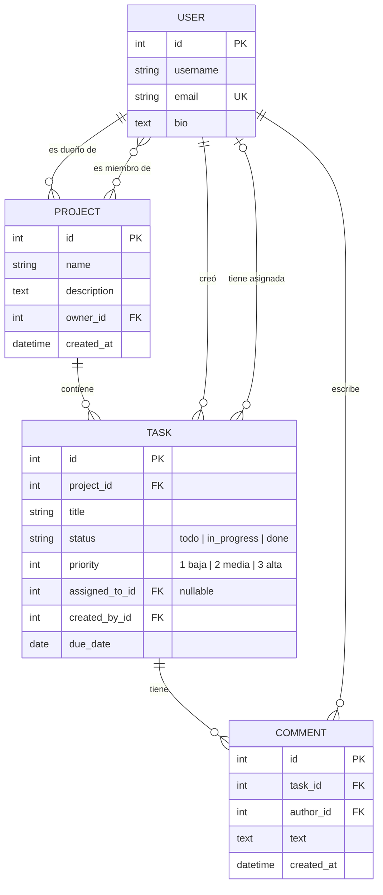
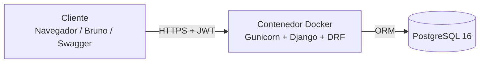

# ✅ TaskFlow: API de gestión de proyectos y tareas en equipo

Proyecto final de **Backend**. Es una API REST con **Django + Django REST Framework + PostgreSQL**: autenticación JWT, permisos por objeto, Docker, pruebas con **Bruno**, tests automáticos y despliegue en la nube.

**Autor:** Alejandro Nuñez

| | |
|---|---|
| 🌐 **Demo en vivo** | https://taskflow-sw07.onrender.com |
| 📖 **Documentación de la API (Swagger)** | https://taskflow-sw07.onrender.com/api/docs/ |
| 💻 **Repositorio** | https://github.com/AlejandroNZ11/taskflow-backend |

> La demo usa el plan gratuito de Render: si estuvo inactiva, la primera carga puede tardar alrededor de 1 minuto.

### Usuarios de prueba

| Usuario | Contraseña | Rol |
|---|---|---|
| `demo` | `Demo12345!` | Dueño del proyecto "Proyecto Final Backend" |
| `ana` | `Demo12345!` | Miembro del mismo proyecto (no puede borrarlo) |

---

## 📌 ¿Qué hace?

Los usuarios se registran e inician sesión, crean **proyectos**, invitan **miembros** y organizan **tareas** con estado, prioridad, responsable y fecha límite. También pueden **comentar** las tareas y consultar **estadísticas** de avance de cada proyecto.

| Característica | Implementación |
|---|---|
| Usuarios | Modelo `User` personalizado (email único), registro con validación de contraseña, perfil editable |
| Autenticación | **JWT** (access + refresh) con `djangorestframework-simplejwt` · sesión de Django para el frontend |
| Autorización | Cada usuario ve **solo** sus proyectos (404 si no es miembro) · solo el dueño edita o borra el proyecto y gestiona miembros · solo el creador o el dueño borra una tarea · solo el autor edita su comentario |
| API REST | CRUD completo con `ModelViewSet`, paginación, **filtros**, **búsqueda** y **ordenamiento** |
| Lógica de negocio | Estadísticas por proyecto, tareas vencidas, "mis tareas", validación de que el responsable sea miembro, no se puede mover una tarea a otro proyecto |
| Seguridad | Rate limiting (throttling), `ALLOWED_HOSTS`, CSRF, secretos en variables de entorno, contenedor con usuario sin privilegios |
| Documentación | **OpenAPI / Swagger** generado automáticamente (`drf-spectacular`) |
| Calidad | **37 tests automáticos** (API, permisos, frontend) · colección de **Bruno** con tests |
| Infraestructura | **Docker** + docker-compose + **PostgreSQL 16** + Gunicorn + WhiteNoise · health check en `/health/` |
| Despliegue | **Render** (Blueprint `render.yaml`) · preparado también para **AWS** (EC2 / RDS) |

## 🛠️ Tecnologías

Python 3.14 · Django 5.2 · Django REST Framework 3.16 · SimpleJWT · django-filter · drf-spectacular · PostgreSQL 16 · Docker · Gunicorn · WhiteNoise · Bruno · Render · Bootstrap 5 (frontend básico)

---

## 🗃️ Modelo de datos



## 🏗️ Arquitectura



```
├── config/        # settings (variables de entorno), urls, middleware de health check
├── accounts/      # usuarios: modelo, registro, login JWT, perfil
├── projects/      # proyectos, tareas, comentarios: modelos, serializers, viewsets, permisos, tests
│   └── management/commands/seed_demo.py   # datos de demo
├── web/           # frontend básico con templates de Django
├── bruno/         # colección de Bruno para probar la API
├── Dockerfile · docker-compose.yml · entrypoint.sh
└── render.yaml    # infraestructura de Render (base de datos + servicio web)
```

---

## 📡 Endpoints

Todos requieren el header `Authorization: Bearer <access_token>`, salvo registro, login y refresh.

| Método | Endpoint | Descripción |
|---|---|---|
| POST | `/api/auth/register/` | Registrar usuario |
| POST | `/api/auth/login/` | Login → devuelve `access` y `refresh` |
| POST | `/api/auth/refresh/` | Renovar el `access` token |
| GET / PATCH | `/api/auth/me/` | Ver o editar mi perfil |
| GET / POST | `/api/projects/` | Listar (`?search=`, `?ordering=`) / crear proyectos |
| GET / PUT / PATCH / DELETE | `/api/projects/{id}/` | Detalle / editar / borrar (solo el dueño modifica) |
| POST | `/api/projects/{id}/members/add/` | Agregar miembro `{"username": "ana"}` (solo el dueño) |
| POST | `/api/projects/{id}/members/remove/` | Quitar miembro (sus tareas quedan sin asignar) |
| GET | `/api/projects/{id}/stats/` | Tareas por estado y prioridad, vencidas, % de avance |
| GET / POST | `/api/tasks/` | Listar con filtros / crear tareas |
| GET / PUT / PATCH / DELETE | `/api/tasks/{id}/` | Detalle / editar / borrar |
| GET | `/api/tasks/mine/` | Tareas asignadas al usuario logueado |
| GET / POST | `/api/comments/?task={id}` | Comentarios de una tarea |
| GET / PATCH / DELETE | `/api/comments/{id}/` | Solo el autor modifica |
| GET | `/health/` | Estado de la app y de la base de datos |

**Filtros de tareas:** `?project=1&status=todo&priority=3&assigned_to=2&due_date__lte=2026-12-31&search=docker&ordering=-priority`

Ejemplo:

```bash
curl -X POST https://taskflow-sw07.onrender.com/api/auth/login/ -H "Content-Type: application/json" -d "{\"username\": \"demo\", \"password\": \"Demo12345!\"}"
```

---

## 🚀 Cómo ejecutarlo

### Opción 1: Docker (recomendada)

Requisitos: Docker Desktop.

```bash
git clone https://github.com/AlejandroNZ11/taskflow-backend.git
```

```bash
cd taskflow-backend
```

```bash
cp .env.example .env
```

```bash
docker compose up --build
```

Esto levanta **PostgreSQL** y **Django**. Al iniciar se aplican las migraciones, se crea el superusuario definido en `.env` y se cargan los datos de demo. La app queda en http://localhost:8000.

### Opción 2: Local con SQLite

Requisitos: Python 3.12 o superior.

```bash
python -m venv venv
```

```bash
venv\Scripts\activate
```

```bash
pip install -r requirements.txt
```

```bash
python manage.py migrate
```

```bash
python manage.py seed_demo
```

```bash
python manage.py runserver
```

| URL | Qué es |
|---|---|
| http://localhost:8000 | Frontend |
| http://localhost:8000/api/docs/ | Swagger |
| http://localhost:8000/admin/ | Panel de administración |

### Tests

```bash
python manage.py test
```

Con Docker: `docker compose exec web python manage.py test`. Así los tests corren contra PostgreSQL.

### Probar con Bruno

1. Abrir Bruno → **Open Collection** → carpeta `bruno/TaskFlow`.
2. Elegir el environment **Local** o **Render**.
3. Ejecutar **01 Auth → Login**: el JWT se guarda automáticamente en `{{accessToken}}`.
4. Clic derecho en la colección → **Run** para ejecutar todos los requests con sus tests.

---

## ☁️ Despliegue

### Render (en producción)

El archivo [`render.yaml`](render.yaml) define la infraestructura como código: una base **PostgreSQL** y un **servicio web Docker**. Render inyecta `DATABASE_URL` y genera `DJANGO_SECRET_KEY`. Cada `git push` a `main` despliega automáticamente.

Para reproducirlo: en Render, **New + → Blueprint →** elegir este repositorio.

### AWS (alternativa)

**EC2 con Docker:**
1. Crear una instancia Ubuntu `t2.micro` o `t3.micro` y abrir los puertos 22 y 80 en el Security Group.
2. Instalar Docker (`curl -fsSL https://get.docker.com | sudo sh`).
3. Clonar el repositorio y crear el `.env` con `DJANGO_ALLOWED_HOSTS=<IP pública>`.
4. Cambiar el puerto a `"80:8000"` en `docker-compose.yml` y ejecutar `docker compose up -d --build`.

**Con RDS:** poner el endpoint de RDS en `POSTGRES_HOST` y usar `docker compose -f docker-compose.prod.yml up -d --build` (solo la app, sin el contenedor de base de datos).

---

## 🔐 Variables de entorno

Ver [`.env.example`](.env.example). Las principales:

| Variable | Uso |
|---|---|
| `DJANGO_SECRET_KEY` | Clave secreta de Django |
| `DJANGO_DEBUG` | `0` en producción |
| `DJANGO_ALLOWED_HOSTS` | Dominios permitidos |
| `DATABASE_URL` | Conexión a PostgreSQL (Render / RDS) |
| `POSTGRES_*` | Conexión a PostgreSQL (docker-compose) |
| `DJANGO_SUPERUSER_*` | Superusuario creado al iniciar |
| `SEED_DEMO` | `1` para cargar datos de demo |

Sin variables de base de datos, la app usa SQLite para desarrollo local.
